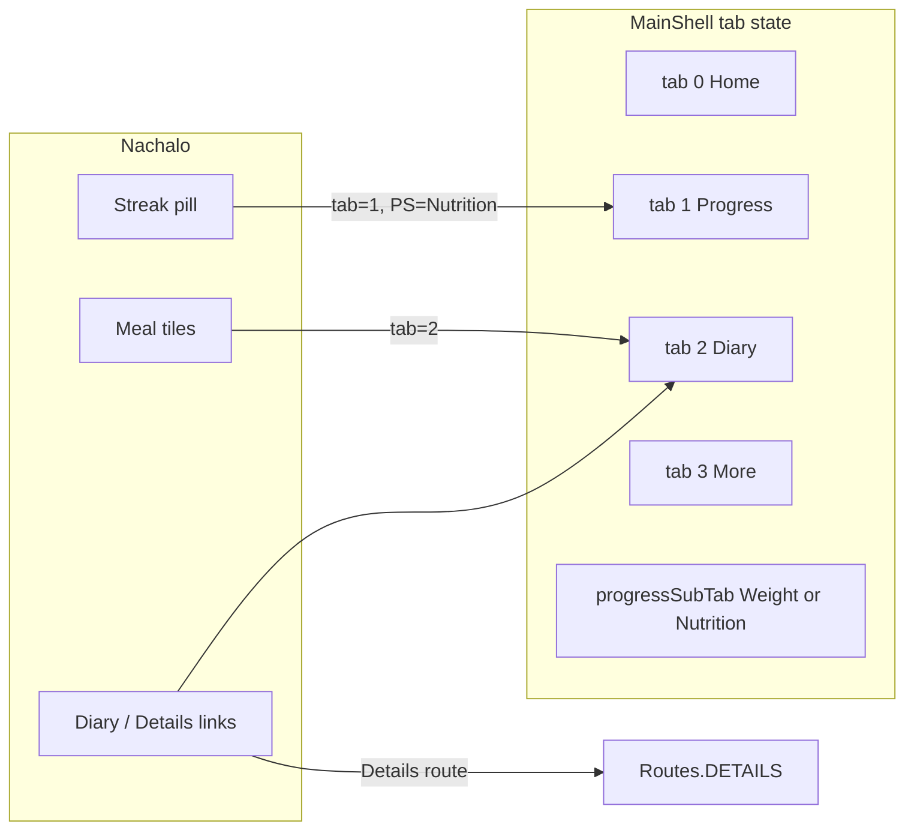

# Reference UI redesign plan

## Състояние / Status (updated 2026-10-17)

Read from the source, not from the checklist above: **the reference redesign is built**. Only the manual device pass is still open.

| Area | State |
|------|-------|
| Theme + shared primitives — `SectionCard`, `SectionHeader`, `SettingsGroup`/`SettingsRow`, `HomeTopBar`, `MainBottomBar` ([ReferenceCards.kt](app/src/main/java/com/bulgarcal/tracker/ui/components/ReferenceCards.kt)) | done |
| Data/VM — range queries, `waterGoalMl`, `loggingStreak`, `addWeight`, `removeLastWater` | done |
| Начало — ring + macro bars, ХРАНЕНИЯ → Дневник, КАЛОРИЙНО СЪОТНОШЕНИЕ, ВОДА + size sheet, ЦЕЛЕВО ТЕГЛО | done |
| MainShell tabs + `progressSubTab` deep links; macro edit from Начало / Прогрес | done |
| Прогрес — Тегло / Хранене tabs, range chips, weight + calorie + water charts | done |
| Още — grouped rows, Профил (read-only), Вашите числа, «Очаквайте скоро» rows | done |
| **Начало — meal tiles** | done — tapping Закуска / Обяд / Хапване / Вечеря opens the add-food flow with that meal pre-selected instead of always landing on Обяд (`pendingMeal`); the «Дневник >» header still opens Дневник |
| **Add-food default meal** | done — when nothing was picked (bottom «+», Дневник «(+)», notification) the sheet selects the meal that fits the clock: 05–10 Закуска, 11–15 Обяд, 16–17 Хапване, 18–04 Вечеря (`MealType.forCurrentTime()`, `LogFoodSheet.initialMeal = null`) |
| **Add-food sheet — macros** | done — Енергия / Въглехи / Протеини / Мазнини for the grams you type, scaled exactly like the stored log (`value * grams / servingGrams`) |
| **Любими on the add-food screen** | done — category row right after «Моите Рецепти» → `FavoriteFoodsScreen` (route `favorites`), tap a favourite to log it, «Няма любими храни.» when empty. The earlier idea of listing the favourites inline was dropped on your later request, so a long favourites list can never push the categories down. |
| qa-pass — device pass on a real phone | open |

**Final Начало order (top → bottom):** date + streak (`HomeTopBar`) → calorie ring + 3 macro bars + «… kcal изядени · …% от целта» → ХРАНЕНИЯ (Закуска, Обяд, Хапване, Вечеря; «Дневник >») → КАЛОРИЙНО СЪОТНОШЕНИЕ (+ «Детайли >», «Цел — C / P / F», «Редактиране >») → ВОДА → ЦЕЛЕВО ТЕГЛО. So the macro chart sits after the meal cards and directly above ВОДА, and ВОДА / ЦЕЛЕВО ТЕГЛО close the screen.

**Deliberately not built:** premium «Платена версия», Coach card, and the reference's bottom «ОТ ЕКИПА — Харесва ли ти приложението? … Сподели >» block. Meal tiles read Закуска, Обяд, Хапване, Вечеря — the same labels and order as the reference screenshot (`MealType.SNACK.label` = «Хапване»).

**Built then removed at your request:** the «Бързо добавяне на храна» button on Начало — meal tiles and the centre «+» are the way to add food.

**Unchanged by design:** Дневник, the food search stack, onboarding, reminders.

---

## Current state (baseline) — historical, superseded by the table above

| Area | Today | Gap vs reference |
|------|--------|------------------|
| [HomeScreen.kt](app/src/main/java/com/bulgarcal/tracker/ui/home/HomeScreen.kt) | Title “Начало”, 3-column calorie row, meals open **food search**, water via dropdown + drink chips | Ring “целево табло”, header date + streak, meal → **Дневник**, ratio card, water +/- + bottom sheet, target weight card, section order |
| [ProgressScreen.kt](app/src/main/java/com/bulgarcal/tracker/ui/progress/ProgressScreen.kt) | Month navigator + simple weight line | **Тегло / Хранене** toggle, range chips, nutrition stats/charts, water weekly card, styled weight chart |
| [MoreScreen.kt](app/src/main/java/com/bulgarcal/tracker/ui/more/MoreScreen.kt) | Flat text list | Grouped cards, icons, subtitles; **Вашите числа** screen; disabled rows |
| [AppNavigation.kt](app/src/main/java/com/bulgarcal/tracker/navigation/AppNavigation.kt) | Tab state local to `MainShell`; meals → `onFoodForMeal` | Deep links: streak → Прогрес/Хранене; meals / “Дневник >” → tab 2 |
| Data | Per-day totals only; no streak; `addWeight` not in VM | Range queries, streak, water goal, `removeLastWater`, ideal weight (Devine) |

**Unchanged:** [DiaryScreen.kt](app/src/main/java/com/bulgarcal/tracker/ui/diary/DiaryScreen.kt), food search stack, onboarding, reminders implementation.

**Omitted (your choice):** Premium “Платена версия”, Coach card, home “От екипа / Сподели” block.

**Profile card:** Title **“Потребител”** by default; optional display name stored in `app_meta` (`display_name`) editable later from read-only profile or a small “Име” row under **ПРИЛОЖЕНИЕ** if you want—minimal first step: meta key + one edit surface on [ProfileReadOnlyScreen](app/src/main/java/com/bulgarcal/tracker/ui/more/ProfileReadOnlyScreen.kt) (new).

---

## Visual system (align with references)

- **Surfaces:** `#121212` / `#1E1E1E` cards ([Color.kt](app/src/main/java/com/bulgarcal/tracker/ui/theme/Color.kt) — tune `EmeraldTeal` toward reference mint ~`#78D7B1` for active nav/links; keep separate **water blue** ~`#38BDF8`).
- **Shared primitives** (new file e.g. [ui/components/ReferenceCards.kt](app/src/main/java/com/bulgarcal/tracker/ui/components/ReferenceCards.kt)):
  - `SectionCard` — rounded 16dp, `SurfaceGray`, internal padding.
  - `SectionHeader(title, actionLabel?, onAction?)` — uppercase grey title + teal “Детайли >” / “Дневник >”.
  - `SettingsGroup` + `SettingsRow(icon, title, subtitle?, enabled, badge?, onClick)` — chevron, dividers inset like reference.
  - `HomeTopBar` — centered date (`Днес` + weekday line e.g. `събота, октомври 3` from `LocalDate` + [TrackerViewModel.dateFmt](app/src/main/java/com/bulgarcal/tracker/TrackerViewModel.kt)), **streak pill** (🔥 + count), profile circle (decorative or → Още).
- **Bottom bar:** Replace floating FAB-only layout with reference-style bar: 4 tabs + **embedded center “+”** (still calls `onFood`). Adjust [MainShell](app/src/main/java/com/bulgarcal/tracker/navigation/AppNavigation.kt) `Scaffold` (custom `Row`/`NavigationBar` with weighted slots and raised center button).



---

## 1. Начало (Home) — layout and behavior

**Replace** body of [HomeScreen.kt](app/src/main/java/com/bulgarcal/tracker/ui/home/HomeScreen.kt) (keep small helpers or move to `HomeSections.kt`).

### 1.1 Header
- Remove screen title “Начало”.
- Pass `selectedDate: LocalDate` from `MainShell` (not only `dateLabel`).
- **Streak pill:** `onStreakClick()` → parent sets `tab = 1`, `progressSubTab = Nutrition`.
- Profile avatar: optional `onProfileClick()` → `tab = 3`.

### 1.2 Целево табло (calorie ring)
- Large **circular progress ring** (Canvas): sweep = `totals.calories / dailyCalories`; center:
  - If under budget: **“{remaining} kcal остават”** + “от {budget} бюджет”.
  - If no intake: reference empty state **“{budget} kcal за деня”** (dashed track).
- Below ring: three **macro columns** (colored labels, `current / target g`, thin bars) — extend [MacroProgressLine](app/src/main/java/com/bulgarcal/tracker/ui/components/CommonComponents.kt) or column variant.
- Footer: **“{eaten} kcal изядени · {pct}% от целта”**.

### 1.3 ХРАНЕНИЯ
- Card with 2×2 grid; meal **emoji/icons** (assets under `res/drawable` or Unicode in Text).
- Header action **“Дневник >”** → `onOpenDiary()`.
- Each meal tile → **`onOpenDiary()`** (remove `onMealClick` → food search from home).
- Show kcal from existing `mealCals`.

### 1.4 КАЛОРИЙНО СЪОТНОШЕНИЕ
- Donut from **eaten** macro kcal shares (or “— няма данни” when `totals.calories == 0`).
- Center label: compare shares to profile percents → **“Извън целта”** / “В целта” (simple threshold).
- Legend with ▲/▼ vs target ratio (reference style).
- **“Детайли >”** → existing `onDetails()` → [MicroDetailsScreen](app/src/main/java/com/bulgarcal/tracker/ui/details/DetailsScreens.kt).
- Bottom row: **“Цел — 50 / 20 / 30”** (from profile percents) + **“Редактиране >”** → `Routes.MACRO_EDIT` (new callback `onMacroEdit` from shell).

### 1.5 ВОДА
- Replace dropdown/chips UI with reference layout:
  - Left: **ring** (% of daily goal).
  - Right: **“{L} / {goal} L”**, **“{n} напитки днес”** (optional (i) tooltip: static hint).
  - Row: **minus** | center **“{increment} ml”** + **“докоснете за промяна ▾”** | **plus**.
  - **Plus:** `addQuickWater()` with current increment.
  - **Minus:** delete **last** log for selected day (new VM method).
  - **Tap center:** [ModalBottomSheet](app/src/main/java/com/bulgarcal/tracker/ui/home/WaterSizeSheet.kt) — **Размер на напитка**: Чаша 200 / Чаша 250 / Бутилка 500 (selected border + checkmark); labels match reference Bulgarian copy.
- **Tip row** (lightbulb + “Храносмилателната система зависи от нея” + chevron): **no** `clickable`, `disabled` semantics — decoration only.

### 1.6 ЦЕЛЕВО ТЕГЛО (new home card)
- Data: `profile`, `weightEntries`, `CalculationEngine.remainingWeeks` / goal type + pace label (“качване 0,25 kg/седм.” from [PaceOption.displayForGoal](app/src/main/java/com/bulgarcal/tracker/data/Enums.kt)).
- Current weight: last entry or `profile.weightKg`.
- Mini **sparkline** (reuse/extend progress chart logic).
- Horizontal **progress bar**: start = first weight entry or onboarding weight; end = `targetWeightKg`; label “остават X kg · Y%”.
- **“Прогрес >”** → `tab = 1`, `progressSubTab = Weight`.
- **“+ Запиши тегло”** → dialog/bottom sheet → `ViewModel.addWeight()` (expose repo method).

### 1.7 HomeScreen API changes (for [AppNavigation.kt](app/src/main/java/com/bulgarcal/tracker/navigation/AppNavigation.kt))
Add callbacks: `onOpenDiary`, `onStreakClick`, `onOpenProgressWeight`, `onMacroEdit`, `onRecordWeight`; pass `selectedDate`, `streak`, `waterGoalMl`, `weightEntries`.

---

## 2. Прогрес (Progress) — full rebuild

Split [ProgressScreen.kt](app/src/main/java/com/bulgarcal/tracker/ui/progress/ProgressScreen.kt) into:

- `ProgressScreen` — header “Прогрес” + profile icon; **segmented control** Тегло | Хранене; state `ProgressSubTab` + `TimeRange` (`W1`, `M1`, `M3`, `M6`, `Y1`, `ALL`).
- `ProgressWeightTab` — reference **ИЗМЕРВАНИЯ** chart: filtered entries, goal dashed line, gradient fill, point markers, summary “Свалени/Качени X kg”.
- `ProgressNutritionTab`:
  - **Средно калории на ден** vs goal; orange under/over copy.
  - Stats row: logged days / days in range, days in calorie band, **🔥 streak** (same algorithm as home).
  - **КАЛОРИИ** 7-day bar chart vs goal line; legend buckets (В целта, Под, Много под, Над, …) — classify each day’s `calories` vs `dailyCalories` with fixed % thresholds.
  - **СРЕДНИ МАКРОСИ / ДЕН** — donut + list + g bars + “Твоят план — C/P/F” + **Редактиране >** → macro edit route.
  - **ВОДА** — weekly bars vs `waterGoalMl` dashed line; legend (В целта / Под / Без запис).

**Initial sub-tab:** `MainShell` holds `var progressSubTab` — set from home streak (Nutrition) or weight card (Weight). Pass into `ProgressScreen(initialSubTab)`.

Remove month-only `DateNavigator` from progress root (range chips replace it); keep month navigation only if needed for weight detail—reference uses relative ranges, not calendar months.

---

## 3. Още (More) — remake

Rewrite [MoreScreen.kt](app/src/main/java/com/bulgarcal/tracker/ui/more/MoreScreen.kt):

| Section | Rows | Behavior |
|---------|------|----------|
| User card | Avatar, **“Потребител”** (or `display_name` from meta), chevron | → new **read-only** [ProfileReadOnlyScreen](app/src/main/java/com/bulgarcal/tracker/ui/more/ProfileReadOnlyScreen.kt) matching reference fields (Пол, Дата на раждане, Ръст, Тегло, Активност, Цел, Желано тегло) — formatted like screenshots, back arrow only |
| **ВАШИЯТ ПЛАН** | Профил (subtitle `{dailyCalories} kcal на ден`), Вашите числа (BMR/TDEE subtitle) | Profile → read-only screen; Numbers → new [YourNumbersScreen.kt](app/src/main/java/com/bulgarcal/tracker/ui/more/YourNumbersScreen.kt) |
| **ХРАНИ И ДАННИ** | Споделени с мен, Експортирай PDF, Свържи с приложения | **Disabled** (grey, no chevron action); PDF shows subtitle **“Очаквайте скоро”** — tap → Snackbar only |
| **ПРИЛОЖЕНИЕ** | Напомняния, Език, Тема | Reminders → existing [RemindersScreen](app/src/main/java/com/bulgarcal/tracker/ui/more/RemindersScreen.kt); Language → read-only **“Български”**; Theme → existing dialog |
| **ПОМОЩ** | Ръководство, Изпрати обратна връзка, Докладвай проблем | **Non-interactive** (no navigation; optional `clickable(enabled = false)`) |

**Routes** in [AppNavigation.kt](app/src/main/java/com/bulgarcal/tracker/navigation/AppNavigation.kt):
- Add `Routes.PROFILE_VIEW`, `Routes.YOUR_NUMBERS`.
- Stop routing Help items to [FeedbackScreen](app/src/main/java/com/bulgarcal/tracker/ui/more/FeedbackScreen.kt) / generic [InfoScreen](app/src/main/java/com/bulgarcal/tracker/ui/more/InfoScreen.kt) from More (screens can remain unused or repurposed for Numbers content).
- **Calendar:** not in reference More list — **remove** from More menu (optional: keep route only if linked elsewhere; currently only More — likely drop from UI).

**Profile editing:** Keep [ProfileEditScreen.kt](app/src/main/java/com/bulgarcal/tracker/ui/more/ProfileEditScreen.kt) reachable from read-only profile via subtle **“Редактиране”** if users must change stats (reference profile is view-only; editing is still required for real app).

---

## 4. Вашите числа (new content)

New [YourNumbersScreen.kt](app/src/main/java/com/bulgarcal/tracker/ui/more/YourNumbersScreen.kt) + extend [CalculationEngine.kt](app/src/main/java/com/bulgarcal/tracker/domain/CalculationEngine.kt):

- **BM / TDEE** — reuse existing BMR/TDEE; copy blocks from reference (Bulgarian explanatory text).
- **Метрика** — static Mifflin–St Jeor formula text (male/female).
- **Идеално тегло** — add `idealWeightDevineKg(sex, heightCm)` (Devine formula, ~72 kg example in screenshot).
- **Килограми до целта** — `abs(current - target)`.
- **Седмици до целта** — existing `weeksToGoal`.

---

## 5. Data layer and ViewModel

### 5.1 DAO queries ([Daos.kt](app/src/main/java/com/bulgarcal/tracker/data/Daos.kt))
- `MealLogDao.dayTotalsInRange(startEpoch, endEpoch)` → list of `(day, calories, carbs, protein, fats)` for charts.
- `MealLogDao.distinctLoggedDaysInRange` or derive from above for “Записани дни”.
- `WaterLogDao.dailyTotalsInRange(start, end)` for progress water chart.

### 5.2 Repository + [TrackerViewModel.kt](app/src/main/java/com/bulgarcal/tracker/TrackerViewModel.kt)
- `fun addWeight(weightKg: Float, date: LocalDate = selectedDate)`
- `fun removeLastWater(date: LocalDate)` — delete max `id` for day.
- `waterGoalMl: StateFlow<Int>` — default **2300** in `app_meta` (`water_goal_ml`), readable for UI (future edit optional).
- `loggingStreak: StateFlow<Int>` — consecutive days ending **today** with `SUM(calories) > 0` (match reference “серия”).
- `progressSnapshot(range): StateFlow<ProgressNutritionUiModel>` — aggregated in VM from range + profile (or compute in composable from flows).

No Room migration if only new queries; meta keys use existing `app_meta` table.

### 5.2 Calorie / water band helpers (domain)
Small functions in `CalculationEngine` or `ProgressAnalytics.kt`:
- `calorieDayStatus(intake, goal): Enum` for bar colors.
- `waterDayStatus(ml, goalMl): Enum`.

---

## 6. Navigation wiring ([AppNavigation.kt](app/src/main/java/com/bulgarcal/tracker/navigation/AppNavigation.kt))

```kotlin
// MainShell state
var tab by remember { mutableIntStateOf(0) }
var progressSubTab by remember { mutableStateOf(ProgressSubTab.Weight) }

HomeScreen(
  onStreakClick = { tab = 1; progressSubTab = Nutrition },
  onOpenDiary = { tab = 2 },
  onOpenProgressWeight = { tab = 1; progressSubTab = Weight },
  onMacroEdit = { nav.navigate(Routes.MACRO_EDIT) }, // from main graph
  ...
)
ProgressScreen(initialSubTab = progressSubTab, onSubTabChange = { progressSubTab = it }, ...)
```

Ensure macro edit from Progress/Home uses same `NavController` as today’s `Routes.MACRO_EDIT` (may require passing `nav` callback into `MainShell`).

---

## 7. Implementation order (recommended)

1. **Theme + shared components** (cards, settings rows, bottom bar).
2. **ViewModel + DAO** (streak, range totals, water goal, addWeight, removeLastWater).
3. **Home** (ring, meals → diary, water sheet, weight card, streak).
4. **MainShell navigation** (tab/sub-tab/deep links).
5. **Progress** (weight + nutrition tabs, charts).
6. **More + Profile read-only + Your numbers + route cleanup**.
7. **Polish:** Bulgarian number formatting (`1 686`, `0,5 L`), content descriptions, lint/compile.

---

## 8. Testing checklist (manual)

- Home streak opens **Прогрес → Хранене** with nutrition content visible.
- Meal tiles and “Дневник >” open **Дневник** tab (no food search).
- Water: change size via bottom sheet; +/- updates totals; tip not clickable.
- “Прогрес >” / weight chart on home opens **Тегло** sub-tab.
- More: Reminders + Theme work; PDF snackbar “скоро”; disabled rows inert; Help rows inert.
- Profile / Numbers screens match reference copy and computed BMR/TDEE/ideal weight.
- Дневник unchanged; center **+** still opens food search.
